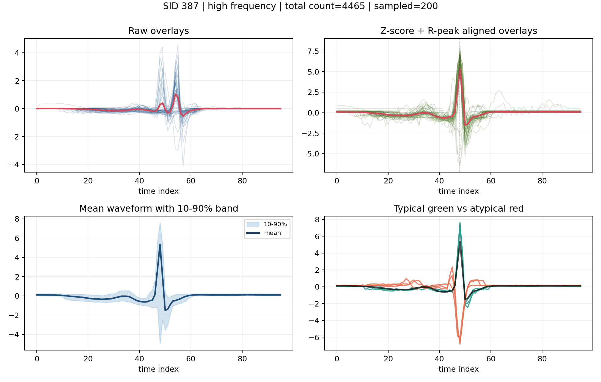
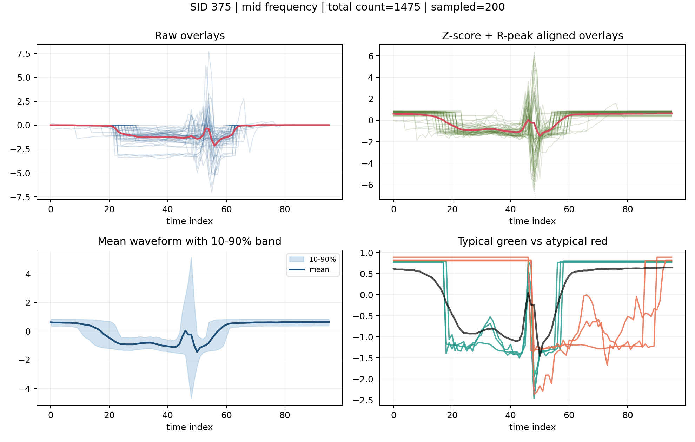
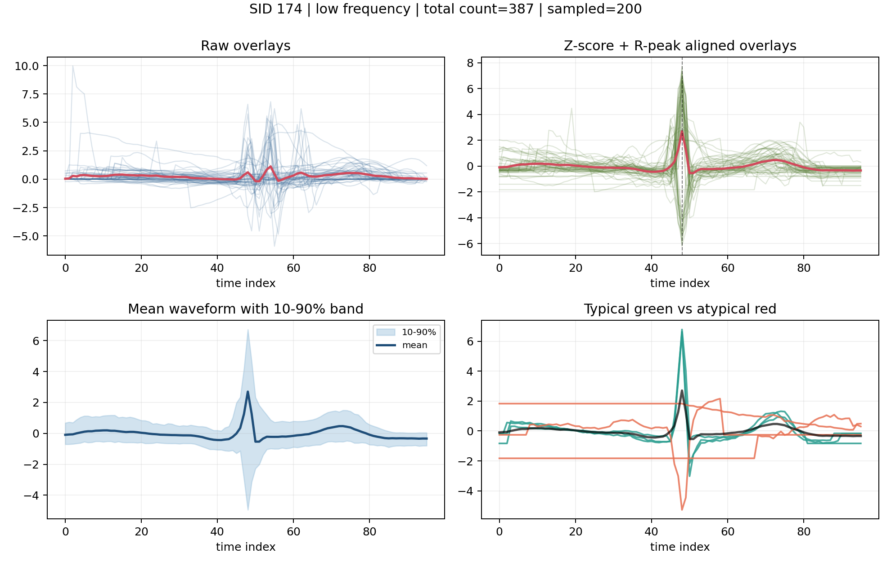
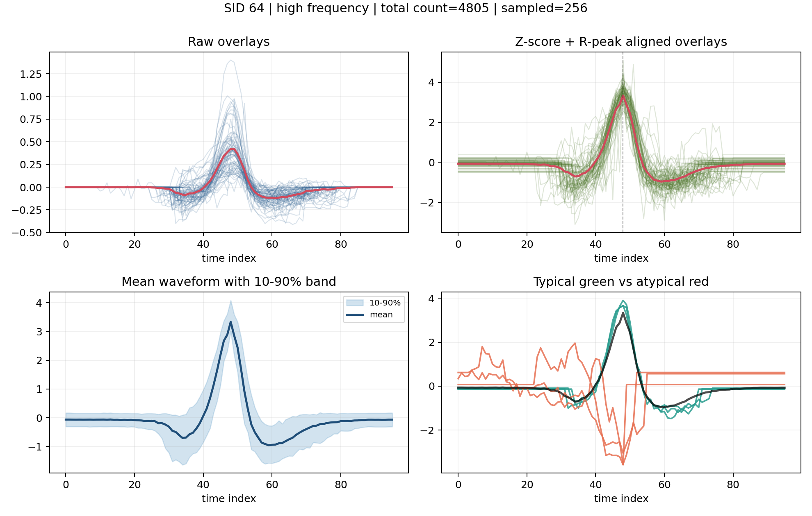
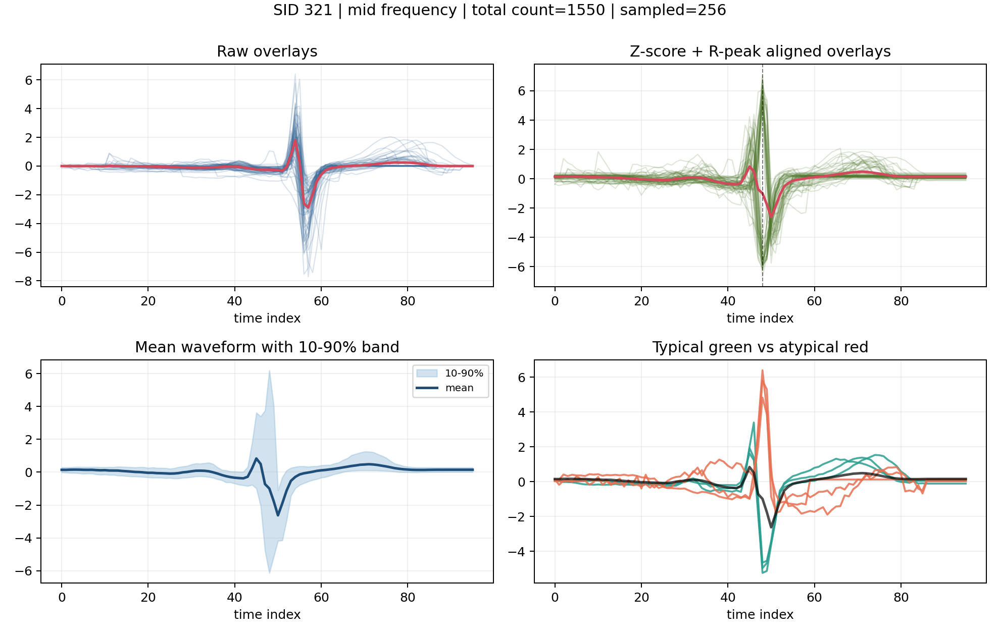
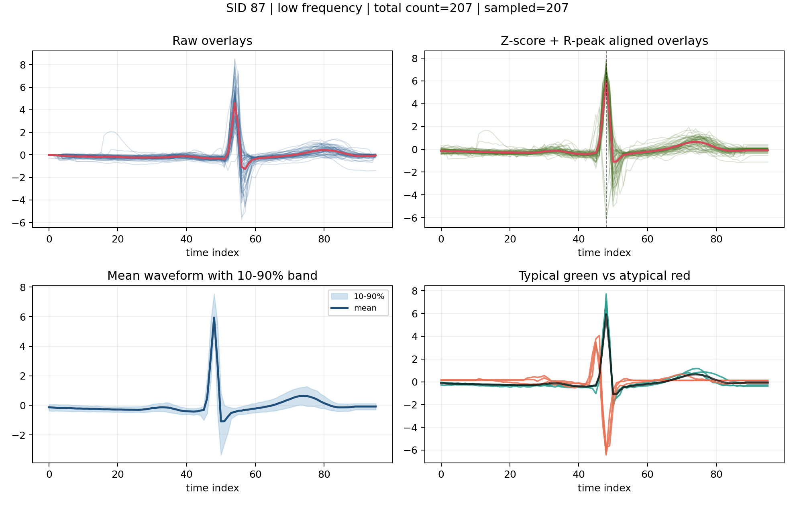
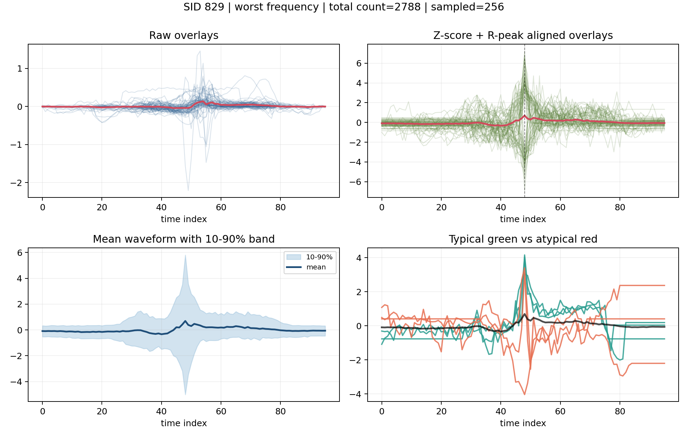
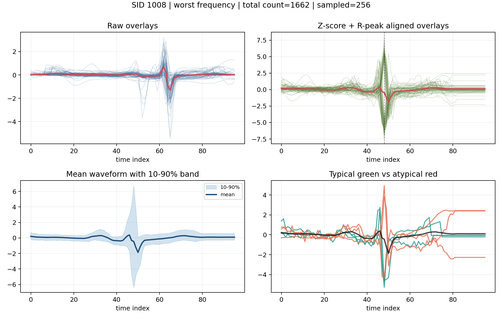
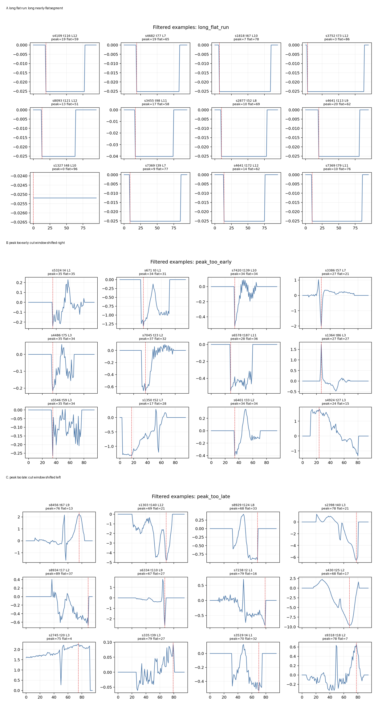

# H 可视化讨论材料

## 结论先行

H 做的是：先过滤约 5% 明显不像正常居中心跳片段的 token，再重新训练 1024 × 64 codebook。

过滤掉的不是正常的少见心跳，而是三类高风险伪影：长平段、R 峰太靠前、R 峰太靠后。

结果是：word 数量少了一点，但同一个 word 内部更像，不同 word 之间更分得开。

| 实验 | active | perplexity | intra RMSE | inter/intra RMSE | intra corr dist | corr 分离比 | silhouette |
|---|---:|---:|---:|---:|---:|---:|---:|
| V2 原始 no balancing | 780 | 703.59 | 1.1134 | 1.1517 | 0.7231 | 1.2456 | -0.4669 |
| V2 clean H | 730 | 652.17 | 0.9696 | 1.3048 | 0.5880 | 1.5105 | -0.3123 |

- 过滤比例：约 4.85%
- 过滤 token 数：56,933 / 1,174,616
- H active word 下降：780 -> 730
- H 形态一致性提升：intra RMSE 1.1134 -> 0.9696，intra corr distance 0.7232 -> 0.5880
- H 分离度提升：RMSE 分离比 1.1517 -> 1.3048，correlation 分离比 1.2456 -> 1.5105

## 汇报逻辑

1. 原始 V2 的 SID 不是随机编号，已经能聚出一些 QRS 原型。
2. 但是原始 V2 中有一部分 SID 被切歪、边界平段、平台化片段污染。
3. 我们没有大规模删数据，只过滤最异常的约 4.85% token。
4. 重新训练 H 后，整体分离指标明显改善，说明 clean 是有效方向。
5. H 中最差 SID 仍有残余问题，下一步应继续改进切分质量、lead/polarity 归一和形态特征评估。

## 精选图

### 01_original_high_sid387.png

原始 V2 高频 SID 387：有稳定平均 QRS 原型，但仍混入少量反向/异常片段。

### 02_original_mid_sid375_mixed.png

原始 V2 中频 SID 375：混杂更明显，可见切分边界/阶梯状/形态不一致片段。

### 03_original_low_sid174.png

原始 V2 低频 SID 174：有平均形态，但方差带较宽，低频 word 更容易被异常样本影响。

### 04_H_high_sid064.png

H 高频 SID 64：clean 后高频 word 的 QRS 原型更集中，内部形态更紧。

### 05_H_mid_sid321.png

H 中频 SID 321：中频 word 仍有一定差异，但整体比原始中频混杂更可控。

### 06_H_low_sid087.png

H 低频 SID 87：低频 word 仍能形成可解释平均形态，说明 clean 没有只保留高频常规心跳。

### 07_H_worst_sid829_residual_issue.png

H 最差 SID 829：clean 后仍存在边缘平台化/残余混杂，是下一步改进切分和 lead/polarity 处理的证据。

### 08_H_worst_sid1008_late_peak.png

H 最差 SID 1008：R 峰位置偏后，说明峰位置过滤阈值已经去掉极端错误，但边界附近问题仍会留下。

### 09_cleaned_token_examples_montage.png

这张图用于证明 clean 掉的是明显异常 token：长平段、峰太靠前、峰太靠后。

## H 最差 SID 摘要

| SID | count | prefix flat12 | suffix flat12 | long flat >=12 | peak p10 | peak p50 | peak p90 | RMSE-to-mean p50 |
|---:|---:|---:|---:|---:|---:|---:|---:|---:|
| 356 | 2220 | 0.38 | 0.36 | 0.43 | 53.0 | 54.0 | 55.0 | 0.943 |
| 444 | 143 | 0.64 | 0.69 | 0.74 | 47.0 | 50.0 | 62.0 | 0.954 |
| 845 | 2714 | 0.35 | 0.37 | 0.43 | 53.0 | 54.0 | 55.0 | 0.854 |
| 262 | 1598 | 0.39 | 0.41 | 0.46 | 51.0 | 53.0 | 54.0 | 0.685 |
| 824 | 197 | 0.34 | 0.27 | 0.36 | 54.0 | 54.0 | 56.0 | 0.777 |
| 695 | 944 | 0.36 | 0.46 | 0.50 | 48.0 | 53.0 | 55.0 | 0.919 |
| 829 | 2788 | 0.76 | 0.73 | 0.82 | 47.0 | 52.0 | 60.0 | 0.976 |
| 357 | 2429 | 0.60 | 0.61 | 0.67 | 47.0 | 54.0 | 60.0 | 0.860 |
| 179 | 111 | 0.25 | 0.67 | 0.71 | 48.0 | 55.0 | 59.0 | 0.987 |
| 970 | 242 | 0.47 | 0.87 | 0.88 | 48.0 | 53.0 | 58.0 | 0.877 |
| 1008 | 1662 | 0.39 | 0.35 | 0.45 | 62.0 | 64.0 | 65.0 | 0.924 |
| 539 | 159 | 0.54 | 0.74 | 0.79 | 48.0 | 54.0 | 58.2 | 0.887 |

## 下周可以直接说的话

> 原始 V2 codebook 已经能学到 ECG 局部形态，但部分 SID 被切分偏移、长平段和边界伪影污染。我们用保守规则只过滤约 4.85% 最异常 token，再重新训练 H。H 的 active word 从 780 降到 730，但 intra distance 明显下降，inter/intra separation 明显上升，说明 codebook 的 word 语义更干净。下一步不是盲目扩大 codebook，而是继续提升切分质量，并验证 SID 是否保留 R 峰、QRS 宽度、振幅等 ECG 形态信息。
